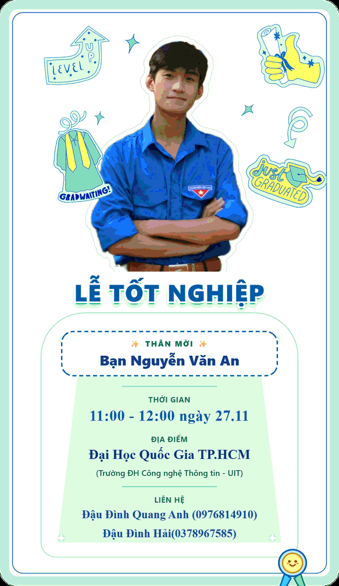

# 🎓 Thiệp Mời Tốt Nghiệp UIT - Đậu Đình Quang Anh

Bộ thiệp mời tốt nghiệp phong cách **Y2K / Cute Gen-Z Doodled & Animated** dành cho Cử nhân **Đậu Đình Quang Anh** - Trường Đại học Công nghệ Thông tin (ĐHQG-HCM).

---

## 🌟 Tính Năng Nổi Bật

1. **Giao Diện Chuẩn Poster Canva (Tông Xanh Dương & Xanh Bạc Hà UIT):**
   - Đúng thứ tự sticker gốc:
     - **Bên Trái:** Mũi tên *LEVEL UP* ➔ Vòng xoáy đôi mint ribbon ➔ Áo thụng cử nhân *GRADWAITING!* ➔ Ngôi sao lấp lánh.
     - **Bên Phải:** Bàn tay giơ ngón cái cầm bằng tốt nghiệp (Diploma Hand) ➔ Mũi tên cong xoáy ➔ Huy hiệu nón cử nhân *Just GRADUATED*.
     - **Góc Dưới Phải:** Huy hiệu nơ mặt trời cười (`rosette-wiggle`).
   - Ảnh chân dung chính chủ độ phân giải cao cắt sticker viền trắng nổi bật.
2. **Hiệu Ứng Hoạt Họa Tự Động (Auto-Float):**
   - Các icon tự đung đưa, xoay nhẹ, lấp lánh liên tục mà không cần hover chuột.
3. **Đầy Đủ Chức Năng Xuất File & In Ấn:**
   - **Tải Ảnh (PNG):** Xuất ảnh thiệp tĩnh 2.5x siêu nét.
   - **Tải Động (.GIF):** Xuất file GIF chuyển động sẵn sàng chia sẻ lên Story / Facebook / Zalo / Instagram.
   - **Nhập / Tải Mẫu Excel:** Tự động điền danh sách khách mời từ file `.xlsx`.
   - **Tải Hàng Loạt (.ZIP):** Xuất toàn bộ thiệp của mọi khách mời thành file nén ZIP trong 1 click.
   - **In / Lưu PDF:** Khổ A5 chuẩn tỉ lệ in ấn.

---

## 📅 Thông Tin Buổi Lễ

- **Thời gian:** 11:00 - 12:00, Ngày **27.11**
- **Địa điểm:** **Đại Học Quốc Gia TP.HCM** *(Trường ĐH Công nghệ Thông tin - UIT)*
- **Liên hệ:**
  - Đậu Đình Quang Anh: 0976814910
  - Đậu Đình Hải: 0378967585
